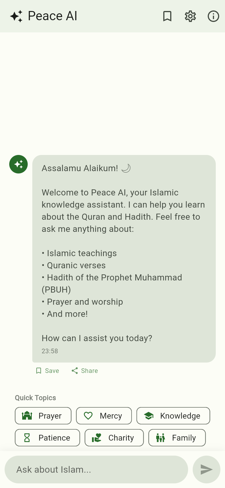
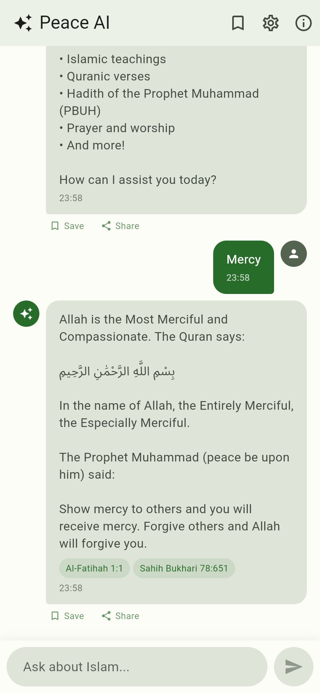
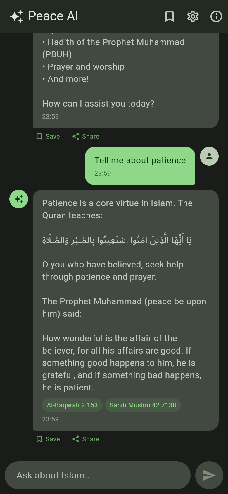
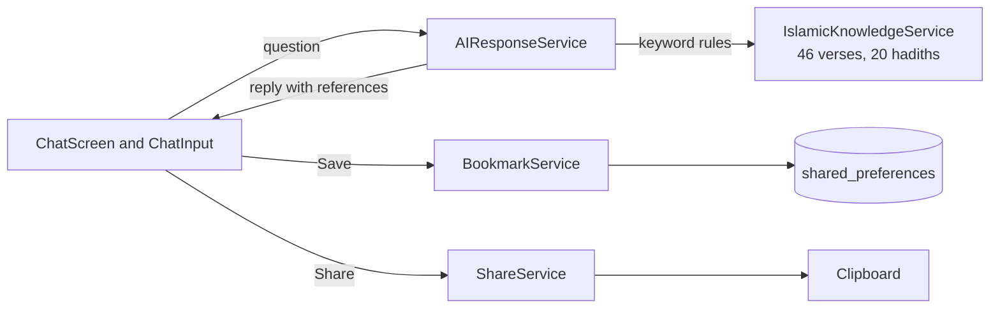

# Peace AI

A Flutter chat app for Android, iOS and the web that answers questions about
Islam with Quran verses and hadiths from a small dataset built into the app.

[](https://github.com/tahmidbintaslim/Peace-AI/actions/workflows/flutter-ci.yml)
[](https://github.com/tahmidbintaslim/Peace-AI/actions/workflows/deploy-pages.yml)

[](LICENSE)

**Live demo:** <https://tahmidbintaslim.github.io/Peace-AI/> (the web build,
deployed from `main` by GitHub Actions; it goes live after the first deploy
once GitHub Pages is enabled, see [Deployment](#deployment))

| Chat screen | A reply with references | Dark theme |
| --- | --- | --- |
|  |  |  |

Status: prototype and learning project. Despite the name there is no AI
model; see [How it works](#how-it-works).

## What it does

You type a question or tap a topic chip, and the app replies with a short
fixed explanation plus at most one Quran verse (Arabic text and English
translation) and at most one hadith (English translation), each with its
reference. Some replies, such as the greeting or the no-match message, have
no verse or hadith. Everything runs on the device: the app's code makes no
network calls. (The web build loads Flutter's CanvasKit renderer and fonts
from Google's CDN, as Flutter web apps do by default.)

The dataset is hard-coded in `lib/services/islamic_knowledge_service.dart`:

- 46 Quran verses from 29 surahs
- 20 hadiths from Sahih Bukhari, Sahih Muslim, Sunan At-Tirmidhi and Sunan
  Ibn Majah

The texts and translations have not been reviewed by a scholar. Check them
against a trusted source before relying on them.

## Features

- Chat screen with six topic chips (Prayer, Mercy, Knowledge, Patience,
  Charity, Family), shown until the first question is sent
- Replies list their Quran and hadith references as chips
- Bookmarks saved on the device with `shared_preferences` (in the browser's
  local storage on the web), with swipe to delete and "Clear all"
- Share button that opens a dialog to copy a reply and its references to the
  clipboard (there is no system share sheet)
- Settings screen with an About dialog, the app version and a Content
  Statistics screen that counts the built-in verses, surahs and hadiths
- Light and dark Material 3 themes that follow the system setting
- 27 tests (`flutter test`): unit tests for the models and services and a
  widget test for the statistics screen

## Tech stack

| Area | Choice |
| --- | --- |
| App | Flutter 3.16.0, Dart 3.2, Material 3 |
| Storage | `shared_preferences` (bookmarks only) |
| Tests | `flutter_test`, `flutter_lints` |
| CI | GitHub Actions: format, analyze, test, Android APK, web, unsigned iOS |
| Hosting | GitHub Pages for the web build |

## How it works



`AIResponseService` lowercases the question and checks it for keywords tied
to about a dozen topics (greeting, Allah, prayer, mercy, knowledge, patience,
charity, character, brotherhood, truth, parents, remembrance). The first
topic that matches picks a fixed explanation and, for every topic but the
greeting, searches the dataset for a related verse or hadith. The checks
are plain substring matches, so "hi" inside "this" or "which" triggers the
greeting.

A question with no topic word that contains "what", "how", "help",
"guidance" or "advice" gets a fixed help message and a verse picked by the
clock. Anything else is searched as one whole phrase in the verse
translations and surah names, then in the hadith translations and narrator
names, so a multi-word question rarely matches and gets the no-match reply.

## Getting started

### Prerequisites

| Target | Needs |
| --- | --- |
| All | [Flutter 3.16.0](https://docs.flutter.dev/release/archive) (ships Dart 3.2.0), the version CI pins |
| Web | Chrome |
| Android | Java 17 (Gradle 7.5 does not run on Java 21) and an Android SDK with platform 34 |
| iOS | macOS with Xcode 15 and CocoaPods |

`pubspec.lock` is committed, so `flutter pub get` resolves the same package
versions CI uses. No environment variables, API keys or `.env` file are
needed.

### Run, test and build

```bash
git clone https://github.com/tahmidbintaslim/Peace-AI.git
cd Peace-AI
flutter pub get

flutter run -d chrome          # or pick an Android/iOS device with `flutter devices`

# The same checks CI runs
dart format --output=none --set-exit-if-changed .
flutter analyze
flutter test

# Release builds
flutter build web --release
flutter build apk --release                    # needs the Android SDK
flutter build ios --release --no-codesign      # macOS only
```

The `android/` and `ios/` folders are complete Flutter 3.16 projects, so no
`flutter create` step is needed. The Gradle wrapper script and jar are not
committed; Flutter generates them on the first Android build. Release APKs
are signed with the debug key (`android/app/build.gradle`); set up your own
signing before publishing to a store. There are no desktop folders.

## Deployment

The web build is published to GitHub Pages by
[`.github/workflows/deploy-pages.yml`](.github/workflows/deploy-pages.yml).
On every push to `main` (or a manual run) it builds with Flutter 3.16.0 and
`--base-href /Peace-AI/`, then deploys `build/web` with
`actions/deploy-pages`. Pull requests run the build only. The deploy job
needs Settings > Pages > Build and deployment > Source set to "GitHub
Actions"; until then it fails and the URL returns 404. To build the same
output locally:

```bash
flutter build web --release --base-href /Peace-AI/
```

[`.github/workflows/flutter-ci.yml`](.github/workflows/flutter-ci.yml) runs
on pushes and pull requests to `main`: `dart format`, `flutter analyze`,
`flutter test`, a release APK and a web build on Ubuntu (the APK is kept as
the `release-apk` workflow artifact), and an unsigned iOS release build on
macOS. The app is not published to Google Play or the App Store.

## Project structure

```
lib/
  main.dart                  App entry point, themes, routes
  models/                    Message, QuranVerse and Hadith models
  screens/                   Splash, chat, bookmarks and settings screens
  services/
    ai_response_service.dart        Keyword rules that build each reply
    islamic_knowledge_service.dart  Built-in verses and hadiths, search
    bookmark_service.dart           Bookmarks in shared_preferences
    share_service.dart              Copy a reply to the clipboard
  widgets/                   Message bubble and chat input
test/widget_test.dart        Model, service and statistics screen tests
web/                         index.html, manifest and icons for the web build
android/, ios/               Flutter 3.16 platform projects
docs/images/                 README screenshots
docs/archive/                First-draft notes from November 2025 (out of date)
```

## Status and roadmap

Prototype. The app logic and the first CI workflow date from November 2025.
In October 2026 the Android and iOS projects and the web deployment were
added, and CI and formatting were fixed. Known limitations:

- Matching is by substring, so short keywords fire inside other words, and
  multi-word questions without a topic word rarely find anything.
- The theme picker in Settings shows a choice but does not change or save
  the theme; the app always follows the system setting.
- The verses, hadiths and translations are unreviewed.
- The Android release build is signed with the debug key, and the main
  Android manifest requests the INTERNET permission although the app makes
  no network calls.

Possible next steps: word-boundary or tokenized matching with tests for each
topic, a working theme setting, and a larger dataset taken from a sourced,
licensed corpus with its citations.

## Contributing

Issues and pull requests are welcome. Run the format, analyze and test
commands above before opening a pull request; CI runs the same checks. See
[CONTRIBUTING.md](CONTRIBUTING.md) for details and the guidelines for
religious content.

## License

MIT. See [LICENSE](LICENSE).
